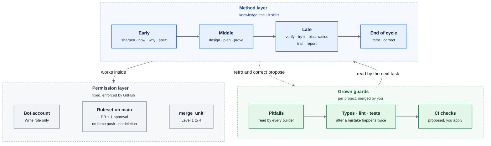
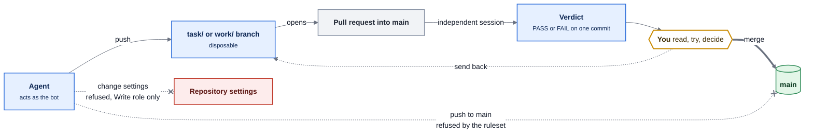
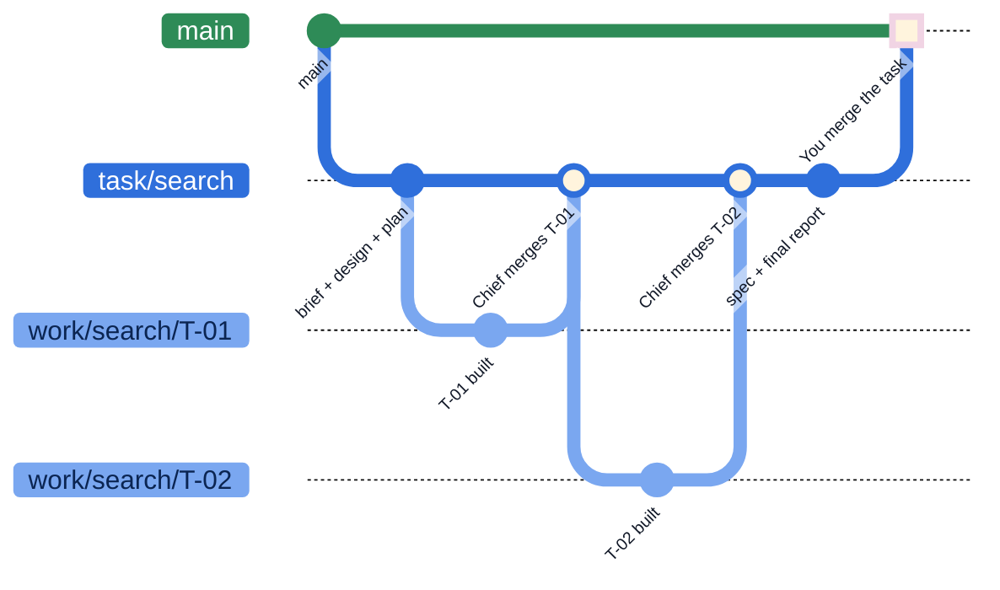
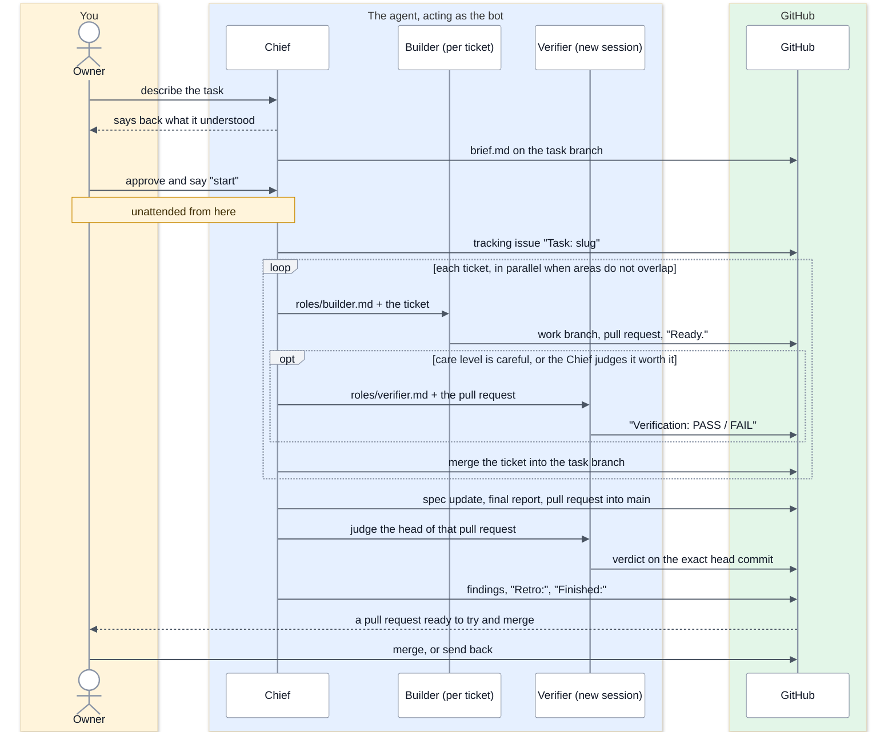
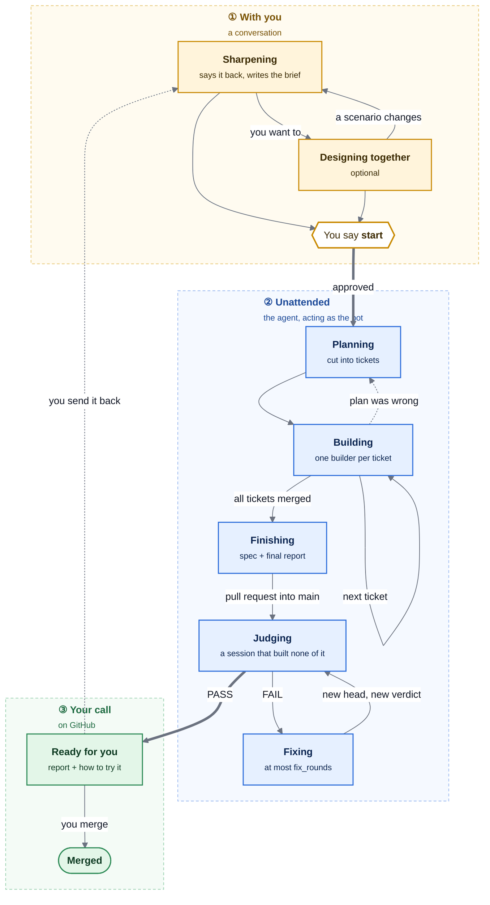
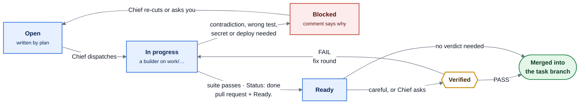
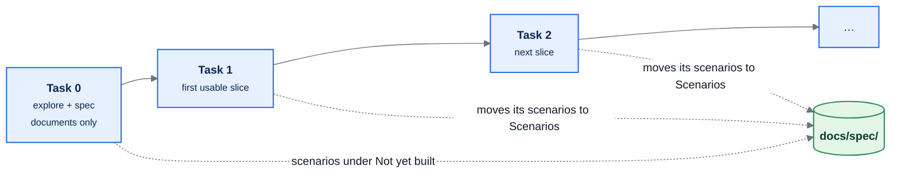
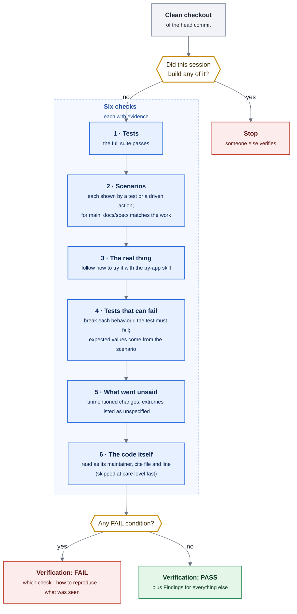
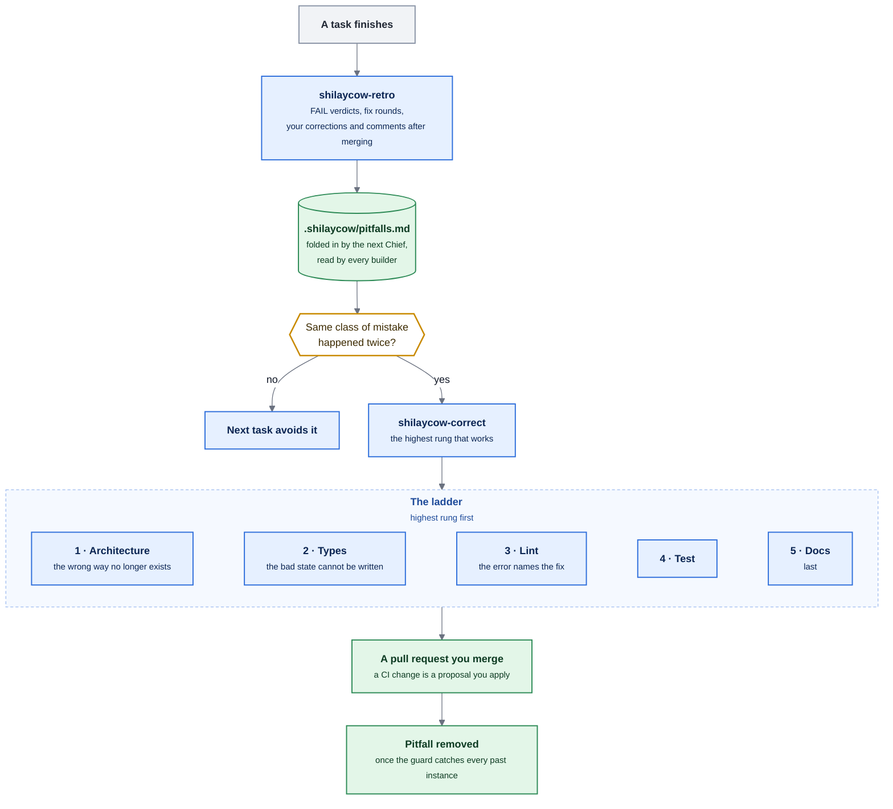

# How shilaycow works

This document explains the harness as a system: what it is made of, what it guarantees, how a task moves from an idea to a merged pull request, and where it can break. The skills themselves (`plugin/skills/*/SKILL.md`) are the exact instructions the agent follows; this is the map that shows how they fit together.

**Contents**

1. [The idea in one paragraph](#1-the-idea-in-one-paragraph)
2. [Three layers](#2-three-layers)
3. [The boundary: what the agent cannot do](#3-the-boundary-what-the-agent-cannot-do)
4. [Levels: how much the agent merges on its own](#4-levels-how-much-the-agent-merges-on-its-own)
5. [Roles: Owner, Chief, builder, verifier](#5-roles-owner-chief-builder-verifier)
6. [The life of a task](#6-the-life-of-a-task)
7. [Verification: how a verdict is reached](#7-verification-how-a-verdict-is-reached)
8. [When the agent stops and asks](#8-when-the-agent-stops-and-asks)
9. [Learning: guards that grow from real mistakes](#9-learning-guards-that-grow-from-real-mistakes)
10. [What appears in your repository](#10-what-appears-in-your-repository)
11. [Where state lives, and how a run resumes](#11-where-state-lives-and-how-a-run-resumes)
12. [When it breaks, and how to recover](#12-when-it-breaks-and-how-to-recover)

---

## 1. The idea in one paragraph

Give the agent as much freedom as possible, and protect only what a mistake could cost you. The protection lives on GitHub's servers, not in instructions the agent has to read and obey: the agent works as a bot account that simply has no permission to change `main`. Inside that boundary, quality is not bought by prescribing steps. It comes from checking results: an independent session that built none of the work tries it the way a user would, breaks each behaviour to see the tests fail, and reads the code as its future maintainer.

Two kinds of rule follow from this, and every rule in the harness is one or the other:

| Kind | It does | Where it lives | Can the agent skip it? |
|---|---|---|---|
| **Guard** | limits what a mistake can cost | GitHub (server side) wherever possible | No |
| **Advice** | describes a way of working that tends to go well | the skills | Yes, with judgement |

---

## 2. Three layers



- **The permission layer** is set up once per repository with `shilaycow-setup` and never changes between levels.
- **The method layer** is the same at every level. At Level 1 you call the skills yourself; from Level 2 up, the Chief calls the same skills.
- **Grown guards** belong to no level. A new project ships with none; each one is added because a mistake actually happened twice in that project.

---

## 3. The boundary: what the agent cannot do

Every action with a large blast radius (irreversible, external, or costly) gets exactly one guard, placed on the server whenever possible.

| Action | Why it is dangerous | Guard | Strength |
|---|---|---|---|
| Changing `main` | the one thing you cannot throw away | Ruleset: pull request required, one approval, no force push, no deletion. The bot opens the pull request, and GitHub does not let an author approve their own | Server side |
| Changing settings, rulesets or collaborators | would remove the guard above | the bot has the Write role, not Admin | Server side |
| Changing CI workflows | could disable required checks | the bot's credentials carry no workflow permission | Server side |
| Reading or leaking secrets | cannot be taken back | the cloud environment holds no secrets | Configuration |
| External side effects (deploy, email, paid APIs) | cannot be taken back | the environment's network allows package registries only; no deploy credentials | Configuration |
| Runaway spending | money and quota | each task has an hours and sessions budget | Written rule |
| Touching another session's branch | destroys someone else's work | each session pushes only its own branch; only the Chief merges into the task branch | Written rule |

**Deliberately not guarded:** files outside a ticket's scope, test configuration, commit authorship, destructive commands inside the container. All of these happen on a branch you can delete or in a container that is thrown away. If one of them keeps causing trouble in your project, it becomes that project's own guard (section 9).



The boundary holds without the agent reading a single word. That is why it is the only thing the harness insists on.

---

## 4. Levels: how much the agent merges on its own

Every level is measured with one ruler: **what is the unit you, the owner, merge?** It is one value in the config:

```yaml
# .shilaycow/config.yml
merge_unit: task     # change | ticket | milestone | task
```

| Level | `merge_unit` | You merge | The agent acts as | The agent merges, on its own | Dispatched by | Setup |
|---|---|---|---|---|---|---|
| 1 | `change` | every change | you | nothing | you, skill by skill | none |
| 2 | `ticket` | one pull request per ticket | the bot | nothing | the Chief | `shilaycow-setup` once |
| 3 | `milestone` | one pull request per milestone | the bot | tickets into `task/<slug>` | the Chief | same as Level 2 |
| 4 | `task` | one pull request per task | the bot | everything into `task/<slug>` | the Chief | same as Level 2 |

Levels 2 to 4 need the same GitHub setup; moving between them is one line in the config. At no level does the agent merge `main`.

What the branches look like at Level 4, with two tickets:



At Level 3 the same thing happens once per milestone; at Level 2 each `work/` branch opens its pull request straight into `main`, and there is no `task/` branch.

---

## 5. Roles: Owner, Chief, builder, verifier

| Role | Who | Does | Never does |
|---|---|---|---|
| **Owner** | you | approves the brief, says "start", answers `needs-owner` issues, merges `main` | — |
| **Chief** | the session you start with `shilaycow-chief` | agrees the brief with you, plans, dispatches, merges tickets into the task branch, writes the report, opens the pull request into `main` | push to or merge `main`; verify its own work |
| **Builder** | a subagent of the Chief, one per ticket, in its own worktree | builds one ticket, proves each behaviour, opens a pull request, posts `Ready.` | change the brief; push outside its branch |
| **Verifier** | a new session that shares nothing with the builders | judges one head commit cold and posts `PASS` or `FAIL` | fix code, push, merge, or coach the builder |

All roles act as the same bot account, so they are told apart by session: every `Ready.` and every verdict carries a `Session:` line, and the Chief rejects a `PASS` whose session matches the Chief's own or any builder's.



The builder never starts its own verifier: whoever is being judged does not write the judge's instructions.

---

## 6. The life of a task

A task has two halves with one explicit handover: **your "start"**.

- **The first half is a conversation.** `shilaycow-sharpen` says back what you asked for in its own words, then turns it into a brief of plain Given / When / Then scenarios. You can also design together here. The Chief dispatches nobody until you say start. Whatever is agreed is written to files on the task branch as you go, so nothing depends on the conversation surviving.
- **The second half is unattended.** The Chief decides everything else: whether a design is needed, how to cut the work, whether to build itself or dispatch builders, which tickets deserve their own verification.

### 6.1 The task as a state machine



Two exits apply from **any** unattended state, so they are not drawn as arrows:

- **Waiting on you:** the agent needs something from the boundary table. It opens a `needs-owner` issue, carries on with whatever that does not block, and resumes the rest once you answer.
- **Stopped:** the budget is used up, the same failure survived `fix_rounds` rounds, or you wrote "stop" on the tracking issue. The run ends; starting `shilaycow-chief` again resumes from what is on GitHub (section 11).

| State | What is true | Written where |
|---|---|---|
| Sharpening | the Chief is restating and asking about outcomes only | `docs/tasks/<slug>/brief.md` |
| Approved | you said start; the level and budget are fixed for the task | first line of the tracking issue |
| Planning | the work is cut into tickets someone could pick up cold | `plan.md`, `tickets/T-nn.md` |
| Building | tickets are being built, proven and merged into the task branch | `work/<slug>/T-nn` pull requests |
| Finishing | `docs/spec/` is brought up to date, the final report is written | `docs/spec/`, `reports/final.md` |
| Judging | an independent session is checking the exact head commit | verdict comment on the pull request |
| Fixing | one fix round; at most `fix_rounds` (default 2) | a new head commit |
| Wrapping | everything after the verdict goes on GitHub, so the judged commit stays the one you merge | comments on the pull request and tracking issue |
| AwaitingOwner | a pull request you can read, try and merge | the pull request |

### 6.2 A ticket as a state machine



### 6.3 The care level

The brief has one dial between speed and assurance. It sets the least the Chief does; it may always do more.

| Care level | Suited to | At least |
|---|---|---|
| fast | prototypes, small tools | the final verification checks behaviour only |
| normal (default) | ordinary features | the final verification also reads the code |
| careful | shared code, data models, public interfaces | design first and weigh a second shape; verify every ticket; run `shilaycow-blast-radius` before the pull request |

### 6.4 Large systems: a chain of tasks

One pull request for a whole system would be too large to review. Large work becomes a chain of tasks, and **the first task's deliverable is the specification itself**:



Each task still merges once, and the spec lands in `main` independently: even if a later task is thrown away, the spec stays.

---

## 7. Verification: how a verdict is reached

`shilaycow-verify` runs in a session that built none of the work, on a clean checkout of one head commit. It treats the builder's claims as claims, not evidence.



Rules that make the verdict trustworthy:

- **Evidence is a command and its output, a screenshot, a file and line.** Never a sentence.
- **One verdict per head commit.** A new commit needs a new verdict, and nothing is pushed after the verdict on the pull request you merge.
- **A finding never turns a PASS into a FAIL, and is never left out to keep a PASS clean.**
- **No behaviour ships on a test that cannot fail.** This is the only rule in the method layer that is enforced.

---

## 8. When the agent stops and asks

In every other situation the agent writes down its assumption (`shilaycow-trail`) and carries on. It stops only when:

| Situation | What it does |
|---|---|
| It needs anything from the boundary table: settings, workflows, secrets, a deploy, an external or paid call | opens an issue labelled `needs-owner` with the options and its recommendation, and continues with whatever that does not block |
| A credential or permission is missing | says what is missing |
| The same failure survives `fix_rounds` rounds | stops and reports |
| The budget (hours or sessions) is used up | stops and reports |
| A scenario cannot be met | opens no pull request into `main`; writes down what is missing |
| You write "stop" on the tracking issue from your own account | ends the run |

---

## 9. Learning: guards that grow from real mistakes

A new project starts with the server-side boundary and nothing else. Guards are added one rung at a time, only after a mistake has actually happened.



What you find wrong after merging is the most valuable input: it is what verification missed. One comment on the finished tracking issue is enough; the next task reads it first.

---

## 10. What appears in your repository

```text
.shilaycow/
  config.yml            settings (below)
  pitfalls.md           mistakes this project has made; builders read it first
.claude/skills/
  try-<app>/            how to start and drive your app, made by shilaycow-try-it
docs/spec/
  index.md              what the system is, its areas, its terms, what it does not do
  <area>.md             the scenarios and rules true in that area today
docs/tasks/<slug>/
  brief.md              goal, out of scope, scenarios, how to try, budget, care level, assumptions
  design.md             the design, when the task needs one
  plan.md               milestones and tickets
  tickets/T-<nn>.md     one per ticket
  trail.tsv             every decision made in place of asking
  evidence/             recordings and outputs
  reports/m<n>.md       checkpoint report per milestone
  reports/final.md      final report, also the description of the pull request into main
AGENTS.md               gains a section pointing at .shilaycow/ and the branch names
```

Only two files have a fixed shape, because you read them: `brief.md` (what you approve) and the final report (what you read before merging). Everything else is "usually here, usually like this".

**Who writes and reads what**

| File | Written by | Read by |
|---|---|---|
| `config.yml` | `shilaycow-setup`, then only you | every skill |
| `pitfalls.md` | the next Chief (from `Retro:` comments), `shilaycow-correct` | `shilaycow-plan`, builders |
| `try-<app>` | `shilaycow-try-it`, during the first task | `shilaycow-verify`, `shilaycow-report` |
| `docs/spec/` | `shilaycow-spec`, before each task's pull request | `shilaycow-sharpen`, `shilaycow-verify`, `shilaycow-how`, builders |
| `brief.md` | `shilaycow-sharpen` | design, plan, verify, report |
| `design.md` | `shilaycow-design` | plan, builders, verify |
| `plan.md`, `tickets/` | `shilaycow-plan` | the Chief, builders, verify |
| `trail.tsv` | the Chief, builders | report, verify, retro, you |
| `reports/` | `shilaycow-report` | you |

**Branches**

| Branch | Purpose |
|---|---|
| `main` | delivered work; only you merge |
| `task/<slug>` | the task's integration branch (Levels 3 and 4); `docs/tasks/<slug>/` lives here |
| `work/<slug>/T-<nn>` | one ticket's work |
| `spike/<topic>` | a throwaway prototype; never merged, only its decisions come back |

**The config**

```yaml
# .shilaycow/config.yml
owner: example-owner
bot: example-bot              # may be empty at Level 1
merge_unit: task              # change | ticket | milestone | task  (Level 1 to 4)
test_command: ""              # your test command, if any
budget:
  hours: 8
  sessions: 20
parallel_builders: 2
fix_rounds: 2
report_language: en           # briefs and reports; headings stay in English
```

With no config, every skill behaves as Level 1. The copy on `main` is the one that counts; you can name another level when starting a task, and a task's level is fixed once it starts.

---

## 11. Where state lives, and how a run resumes

Nothing important lives in a conversation. Conversations are compressed and sessions end; a decision that exists only in a chat is treated as never made.

| State | Lives in |
|---|---|
| What was agreed | `brief.md`, `design.md` on the task branch |
| Progress, level, budget | the tracking issue `Task: <slug>`: its first line, then one line each time something lands or waits |
| Decisions made without asking | `trail.tsv` |
| Readiness and verdicts | `Ready.` and `Verification:` comments on pull requests, each tied to a head commit and a `Session:` |
| Questions for you | issues labelled `needs-owner` |

Because of this, starting `shilaycow-chief` again on the same task resumes it: the Chief rebuilds its picture from the repository and GitHub every time. `shilaycow-status` reads the same sources to tell you, without changing anything, what the task is waiting on and what to do next.

---

## 12. When it breaks, and how to recover

| Situation | Consequence | What limits it |
|---|---|---|
| The final pull request is large and you do not read it closely | a problem reaches `main` | the verifier drives every scenario; the report lists every decision the agent made on its own; your test command can be a required check |
| The cloud session is connected to your account, not the bot | the agent acts as you and the ruleset does not apply to it | the Chief checks its GitHub identity before any unattended work and stops if it is not the configured bot |
| Permission prompts are turned off at Level 1 | same as above | documented; cannot be detected |
| The project gains production, real users or secrets | the boundary table is no longer enough | out of scope; `shilaycow-setup` warns when it sees deploy configuration or secrets |
| Builder and verifier are the same model on the same account | verification catches honest mistakes only | accepted: the agent is assumed to cooperate and err, not to cheat; you are the final gate |
| Parallel builders edit the same file | merge conflicts | the Chief runs in parallel only tickets whose areas do not overlap |
| `main` changes during a task | the final pull request conflicts | the Chief merges `main` into the task branch; the conflict happens on a branch you can throw away |
| Tests are written to match the code instead of the scenario | wrong behaviour is locked in as correct | expected values must come from scenarios; the verifier breaks each behaviour; repeats become a grown guard |
| Too much process for a small task | the process constrains the model | depth scales with the task; the Chief says what it skipped |

**Worst cases and how to undo them**

- **A bad task was merged:** press Revert on its pull request. A task is one merge commit, so undoing it is one action.
- **A task went wrong before merging:** close the pull request and delete the task branch. `main` never changed.
- Both rely on the project having no production database or deployment, which is why that is out of scope.
