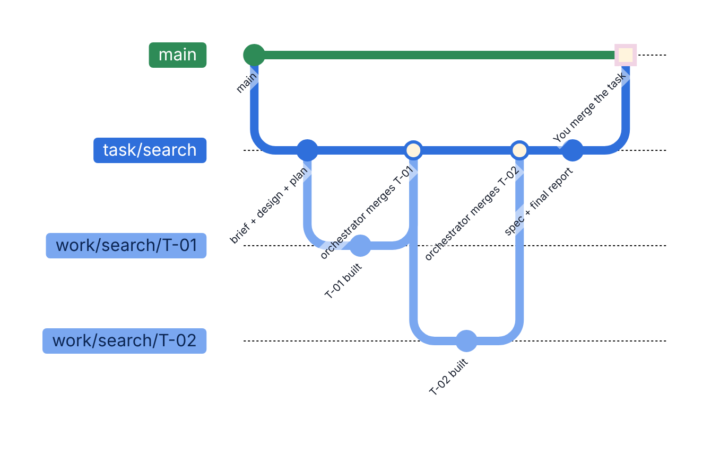
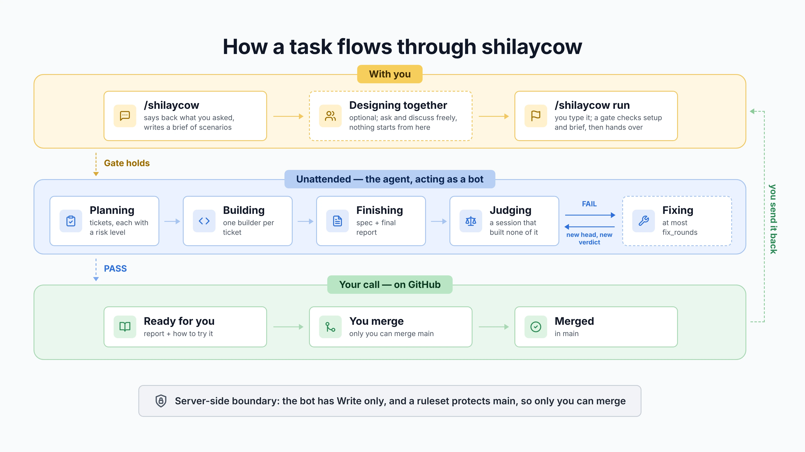
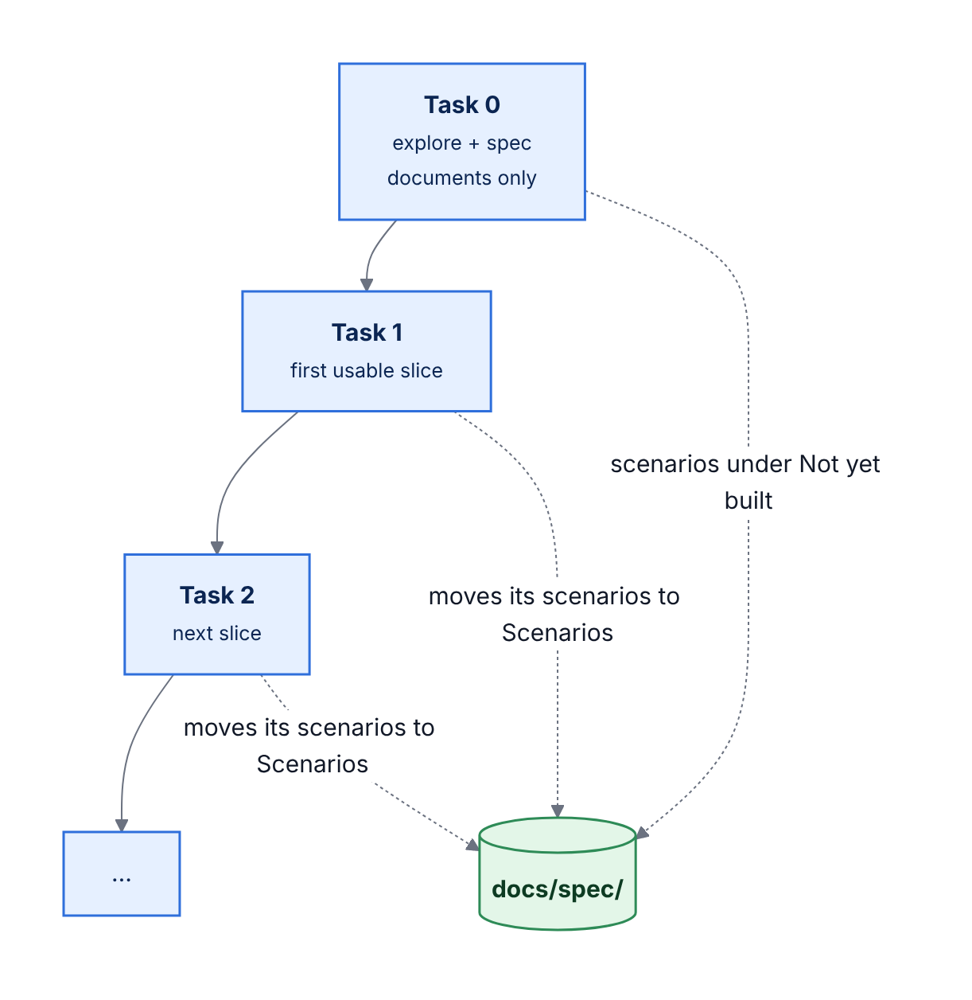

# How shilaycow works

This document explains the harness as a system: what it is made of, what it guarantees, how a task moves from an idea to a merged pull request, and where it can break. The skills themselves (`plugin/skills/*/SKILL.md`) are the exact instructions the agent follows; this is the map that shows how they fit together.

**Contents**

1. [The idea in one paragraph](#1-the-idea-in-one-paragraph)
2. [Three layers](#2-three-layers)
3. [The boundary: what the agent cannot do](#3-the-boundary-what-the-agent-cannot-do)
4. [Modes: manual or auto](#4-modes-manual-or-auto)
5. [Roles: Owner, orchestrator, builder, verifier, reader, steward](#5-roles-owner-orchestrator-builder-verifier-reader-steward)
6. [The life of a task](#6-the-life-of-a-task)
7. [Verification: how a verdict is reached](#7-verification-how-a-verdict-is-reached)
8. [When the agent stops and asks](#8-when-the-agent-stops-and-asks)
9. [Learning: guards that grow from real mistakes](#9-learning-guards-that-grow-from-real-mistakes)
10. [What appears in your repository](#10-what-appears-in-your-repository)
11. [Where state lives, and how a run resumes](#11-where-state-lives-and-how-a-run-resumes)
12. [When it breaks, and how to recover](#12-when-it-breaks-and-how-to-recover)

---

## 1. The idea in one paragraph

Give the agent as much freedom as possible, and protect only what a mistake could cost you. The protection lives on GitHub's servers and in your repository, not in instructions the agent has to read and obey: the agent works as a bot account that simply has no permission to change `main`, GitHub refuses to merge a head no independent verifier passed, and Claude Code's own permission rules refuse the merge tools. Inside that boundary, quality is not bought by prescribing steps. It comes from checking results: an independent session that built none of the work tries it the way a user would, breaks each behaviour to see the tests fail, and reads the code as its future maintainer.

Two kinds of rule follow from this, and every rule in the harness is one or the other:

| Kind | It does | Where it lives | Can the agent skip it? |
|---|---|---|---|
| **Guard** | limits what a mistake can cost | GitHub (server side) wherever possible | No |
| **Advice** | describes a way of working that tends to go well | the skills | Yes, with judgement |

---

## 2. Three layers

<p align="center"></p>

- **The permission layer** is set up once per repository with `shilaycow-setup` and is needed only for auto mode.
- **The method layer** is the same in both modes. In manual mode you call the skills yourself; in auto mode the orchestrator calls the same skills.
- **Grown guards** belong to neither mode. A new project ships with none; each one is added because a mistake actually happened twice in that project.

---

## 3. The boundary: what the agent cannot do

Every action with a large blast radius (irreversible, external, or costly) gets exactly one guard, placed on the server whenever possible.

| Action | Why it is dangerous | Guard | Strength |
|---|---|---|---|
| Changing `main` | the one thing you cannot throw away | Ruleset: pull request required, one approval, no force push, no deletion. The bot opens the pull request, and GitHub does not let an author approve their own. Claude Code's `permissions.deny` also refuses `gh pr merge` and the GitHub merge tools, in a session acting as you too | Server side, and the host |
| Merging a head nobody judged | a push after the verdict, or a branch updated from `main`, would reach you unchecked | the workflow `shilaycow-verdict` posts the status `shilaycow/verdict` on the head of every pull request into `main`: green only when the newest verdict by the bot naming that exact commit is a PASS, so a pull request another account opened is red too. The PASS counts only from a session that built none of it: its `Session:` may not be one that signed a `Ready.` comment or a commit's `Claude-Session:` trailer. Every commit must be linked to the bot or to you, so one made under git's default identity is red. The ruleset requires it from GitHub Actions, with branches up to date, so the commit merged is the commit judged; a status the bot posts does not count, | Server side |
| Changing settings, rulesets or collaborators | would remove the guard above | the bot has the Write role, not Admin | Server side |
| Changing CI workflows | could disable required checks | a workflow changed on a branch runs only once you merge it: the verdict check runs the copy on `main`, never a pull request's, and the change is in the diff you read | Server side |
| Reading or leaking secrets | cannot be taken back | the cloud environment holds no secrets | Configuration |
| External side effects (deploy, email, paid APIs) | cannot be taken back | the environment's network allows package registries and `github.com` only; no deploy credentials | Configuration |
| Runaway spending | money and quota | the limits of your Claude plan or API account; a run also ends when a defect survives `fix_rounds` or you say stop | Your account |
| Losing work on a task's branch | a forced push overwrites commits | a task has one run, and no role force-pushes: a plain push is refused when the branch has moved | Instructions; git |

**Deliberately not guarded:** files outside a ticket's scope, test configuration, commit authorship, destructive commands inside the container. All of these happen on a branch you can delete or in a container that is thrown away. If one of them keeps causing trouble in your project, it becomes that project's own guard (section 9).

<p align="center"></p>

The boundary holds without the agent reading a single word: the ruleset and the required status are on GitHub's servers, and the deny rules are enforced by Claude Code in every permission mode, whatever the agent has read. That is why it is the only thing the harness insists on.

---

## 4. Modes: manual or auto

There are two ways to use the harness, and the config says which with one value:

```yaml
# .shilaycow/config.yml
mode: auto     # manual | auto
```

| Mode | Who calls the skills | You merge | The agent acts as | The agent merges, on its own | Setup |
|---|---|---|---|---|---|
| `manual` (no config) | you, skill by skill | whatever you choose | you | nothing | none |
| `auto` | the orchestrator: `/shilaycow` agrees a brief with you, `/shilaycow run` runs it | one pull request per task | the bot | tickets into `task/<slug>` | `shilaycow-setup` once |

In both modes the agent never merges `main`. In auto mode every task has the same shape, whatever its size: a branch `task/<slug>` created when the task begins, every file about the task in `docs/tasks/<slug>/` on that branch, tickets built on `work/` branches and merged into it by the orchestrator, and one pull request into `main` at the end. Work too large to review as one pull request becomes a chain of tasks (section 6.4), not a larger task.

What the branches look like, with two tickets:

<p align="center"></p>

---

## 5. Roles: Owner, orchestrator, builder, verifier, reader, steward

| Role | Who | Does | Never does |
|---|---|---|---|
| **Owner** | you | approves the brief, starts the run with `/shilaycow run`, answers `needs-owner` issues, merges `main` | — |
| **Orchestrator** | the session you start with `/shilaycow`, which goes on unattended once you type `/shilaycow run` | agrees the brief with you, plans, dispatches, merges tickets into the task branch, writes the report, opens the pull request into `main` | push to or merge `main`; verify its own work |
| **Builder** | a subagent of the orchestrator, one per ticket, in its own worktree | builds one ticket, proves each behaviour, opens a pull request, posts `Ready.` | change the brief; push outside its branch |
| **Verifier** | a new session that shares nothing with the builders | judges one head commit cold and posts `PASS` or `FAIL` | fix code, push, merge, or coach the builder |
| **Reader** | a subagent that never saw the conversation | reads the brief before you approve it and says back what it asks for and what a builder would have to guess | see the conversation, propose a design |
| **Steward** | a subagent started after the last verdict | records what the task taught as a `Retro:` comment, which the next task folds into the pitfalls file | push, or change code |

All roles act as the same bot account, so they are told apart by session: every `Ready.` and every verdict carries a `Session:` line, and a `PASS` whose session matches one that signed a `Ready.` or a commit is no verdict: the orchestrator rejects it, and the verdict check stays red.

<p align="center"></p>

The builder never starts its own verifier: whoever is being judged does not write the judge's instructions. Every agent the orchestrator starts reads `every-agent.md` first, a few lines that hold for every role (act as the bot, push only your own branch, the card is the whole standard), then its role card. Every session the orchestrator starts is closed once its work is done, including one that stopped or stopped answering; a run leaves no session or worktree behind.

---

## 6. The life of a task

A task has two halves with one explicit handover: **you type `/shilaycow run`**.

- **The first half is a conversation, with `/shilaycow`.** It says back what you asked for in its own words, then turns it into a brief of plain Given / When / Then scenarios. You can also design together here, and ask or discuss as long as you like: nothing you say to the orchestrator starts the run, not even "start". Whatever is agreed is written to files on the task branch as you go, so nothing depends on the conversation surviving.
- **The handover is a command, not a sentence.** Words can be misread; a command cannot. `/shilaycow run` first runs a gate, `state.py`, a script that computes the project's state from git with one right answer for each check: auto mode is on, exactly one task is open, and its brief is the very version you approved: when you approve it, the orchestrator records a `brief-approved` row with the brief's commit, and the gate refuses a brief changed since. Approving and starting are two separate acts, by two parties: the orchestrator records your approval, and only you type the command. Only the boundary and the handover can stop a run. The brief's shape (every heading filled in, scenarios written as Given / When / Then, none promising more than a check could show) is only warned about: you approved the brief as it stands, and its form being off cannot cost what an unwanted unattended run can. The run lists every warning on its tracking issue. One thing a script cannot answer is which account the session acts as: it could only ask GitHub with a credential of its own, which says nothing about the account the session's GitHub tools and pushes use. So the agent asks its own tools (`get_me`) before starting, and the verifier later confirms that the tracking issue and the pull request were opened by the bot. The ruleset on `main` is checked by `/shilaycow-setup`, setting by setting, against the one it ships. If anything fails, it changes nothing and tells you what to fix. Text you type after the command is never taken as an instruction. Neither skill can be started by the model on its own; only you can type them.
- **On a resume,** the same gate runs again: a brief changed after the run started has no approval for its new commit, so the run waits until you approve the change with `/shilaycow`.
- **The second half is unattended.** The orchestrator decides everything else: whether a design is needed, how to cut the work, whether to build itself or dispatch builders, which tickets deserve their own verification.

### 6.1 The task as a state machine

<p align="center"></p>

Two exits apply from **any** unattended state, so they are not drawn as arrows:

- **Waiting on you:** the agent needs something from the boundary table. It opens a `needs-owner` issue, carries on with whatever that does not block, and resumes the rest once you answer.
- **Stopped:** a defect survived `fix_rounds` rounds, or you wrote "stop" on the tracking issue. The run ends; running `/shilaycow run` again resumes from what is on GitHub (section 11).

| State | What is true | Written where |
|---|---|---|
| Sharpening | the orchestrator is restating and asking about outcomes only | `docs/tasks/<slug>/brief.md` |
| Approved | you typed `/shilaycow run` and the gate held | first line of the tracking issue, which names the brief's commit |
| Planning | the work is cut into tickets someone could pick up cold | `plan.md`, `tickets/T-nn.md` |
| Building | tickets are being built, proven and merged into the task branch | `work/<slug>/T-nn` pull requests |
| Finishing | `docs/spec/` is brought up to date if the task changed the system's shape, the pull request's description is written | `docs/spec/`, the pull request into `main` |
| Judging | an independent session is checking the exact head commit | verdict comment on the pull request, and the status `shilaycow/verdict` on that commit |
| Fixing | one fix round fixes the whole class a FAIL names; at most `fix_rounds` (default 2) while a defect remains; once only gaps remain, the verdict is a PASS that lists them | a new head commit |
| Wrapping | everything after the verdict goes on GitHub, so the judged commit stays the one you merge | comments on the pull request and tracking issue |
| AwaitingOwner | a pull request you can read, try and merge | the pull request |

### 6.2 A ticket as a state machine

<p align="center"></p>

### 6.3 Risk, per ticket

How closely work is checked depends on what it touches, not on how big the task is. A large task often splits into many tickets that could not do much harm, while one small ticket can sit at the core of the system. So every ticket, including any work the orchestrator does itself, carries a risk level, set by `shilaycow-blast-radius`:

| Risk | When (the highest that applies) | Verification |
|---|---|---|
| low | documents, tests, or code inside one module that nothing else calls | tests, scenarios, the real thing; the diff is scanned, not read closely, to confirm it touches only what its level says |
| medium | code or an interface that something else calls | every check |
| high | a data model or migration, authentication or permissions, money, anything irreversible or external, concurrency, code most of the system calls, or anything in the brief's **Critical areas** | every check, every behaviour broken rather than a sample, and `shilaycow-blast-radius` on the ticket's diff; designed with a second shape weighed, and verified on its own before it is merged into the task branch |

Planning estimates each level from the ticket. The verifier sets it again from the actual diff and may raise it, never lower it, so the work being judged never decides how lightly it is judged. Changes that came from no ticket count as at least medium. Critical areas are your one input here: the parts of your system where any change matters, which the code alone cannot tell the agent. The final report lists every ticket with its level, so you can see where verification was light.

Every pull request into `main` that changes the system's code also gets `shilaycow-blast-radius` against `main`.

### 6.4 Large systems: a chain of tasks

One pull request for a whole system would be too large to review. Large work becomes a chain of tasks, and **the first task's deliverable is the specification itself**:

<p align="center"></p>

Each task still merges once, and the spec lands in `main` independently: even if a later task is thrown away, the spec stays.

The chain itself is written down in `docs/roadmap.json`: each task's slug, what a user can do once it is merged, what it depends on, its pull request and whether it is done. Every Not yet built scenario names the one task that will build it. `state.py` computes the next task from it, and refuses a roadmap with a loop, an unknown dependency, or a task started before what it depends on is done, so a new session never has to guess. `/shilaycow` proposes it when it sees that a request is several tasks, ordering them so that what is hardest to change later comes first, nothing comes before what it depends on, and every task after the first leaves something you can try. Each task still starts with its own brief and your own start: the orchestrator takes the next task from `state.py`, and marks the task's entry with its pull request, as done, in that task's own pull request. You approve and merge every task; the chain never runs on by itself. So that you are never left wondering what comes next, the task's pull request and its `Finished:` comment end with the roadmap's next task, `/shilaycow` typed with no request proposes it and lists the roadmap as done, next and remaining.

Task 0 has nothing to run, so its verification is different: instead of tests and a try-it run, the verifier checks that the scenarios sit under Not yet built, match the brief, contradict nothing already built, each have a place in the design, and each belong to one task of the roadmap.

---

## 7. Verification: how a verdict is reached

`shilaycow-verify` runs in a session that built none of the work, on a clean checkout of one head commit. It treats the builder's claims as claims, not evidence.

<p align="center"></p>

Rules that make the verdict trustworthy:

- **Evidence is a command and its output, a screenshot, a file and line.** Never a sentence.
- **One verdict per head commit.** A new commit needs a new verdict, and nothing is pushed after the verdict on the pull request you merge. This one is enforced: the required status `shilaycow/verdict` turns red on any head without a PASS, so GitHub refuses to merge it.
- **A finding never turns a PASS into a FAIL, and is never left out to keep a PASS clean.**
- **Every failed item is a defect or a gap.** A gap means users can already do what the scenario says and the verifier saw it work; only the proof or the documents around it fall short. At high risk every failed item is a defect. Only a defect fails the verdict: when every failed item is a gap, the verdict is a PASS with a `### Gaps` list, `Finished:` says how many there are, and each gets an issue for a later task. A gap therefore never makes you override the required check to merge.
- **A FAIL names the class, not one instance.** For each failed item the verifier says where else it searched for the same kind of mistake, so a fix round fixes all of it instead of the one place that was seen.
- **A fix round is judged by what changed.** A new verifier is given the earlier verdict and checks the full suite, every check that failed, and the diff between the two heads; if that diff changes code the product runs, it does every check again. Merging `main` into the branch is judged the same way and is not counted as a fix round.
- **No behaviour ships on a test that cannot fail.** This is the only rule in the method layer that is enforced.

---

## 8. When the agent stops and asks

In every other situation the agent writes down its assumption in the trail and carries on. It stops only when:

| Situation | What it does |
|---|---|
| It needs anything from the boundary table: settings, workflows, secrets, a deploy, an external or paid call | opens an issue labelled `needs-owner` with the options and its recommendation, and continues with whatever that does not block |
| A credential or permission is missing | says what is missing |
| A defect survives `fix_rounds` rounds | stops and reports |
| A scenario cannot be met | opens no pull request into `main`; writes down what is missing |
| You write "stop" on the tracking issue from your own account | ends the run |

---

## 9. Learning: guards that grow from real mistakes

A new project starts with the server-side boundary and nothing else. Guards are added one rung at a time, only after a mistake has actually happened.

<p align="center"></p>

What you find wrong after merging is the most valuable input: it is what verification missed. One comment on the finished tracking issue is enough; the next task reads it first.

The loop runs at the start of the next task, not at the end of this one, so that nothing in it depends on a branch that may be thrown away or a run that may stop early. `/shilaycow` folds every Retro the pitfalls file on `main` does not yet cite, so folding twice changes nothing and a discarded task's lessons are folded again by the next one. It then proposes the corrections that are now due as scenarios of the new task, for you to accept or leave out.

**Gaps and findings wait, on purpose.** A gap (work that does what its scenario says but whose proof or documents fall short) and a finding outside the scenarios are not fixed in the run that found them: each becomes an issue labelled `later`. Patched one by one as they are found, they scatter small fixes across the repository; gathered, they show their shared cause. When a new task touches their area, the orchestrator offers to fold them in; when many are open or they share a cause, it suggests a task of their own; a class seen in two tasks becomes a pitfall, and then a guard. Defects never wait: they are fixed in the run that found them.

**Within one task, a pitfall that comes back is not patched again.** When a defect's cause matches an entry in the pitfalls file, the fix round first lists every instance of the class and adds a guard that fails on each, the way a correction would, and only then fixes.

---

## 10. What appears in your repository

```text
.shilaycow/
  config.yml            settings (below)
  pitfalls.md           mistakes this project has made, with their sources; builders read it first
  worktrees/T-<nn>/     where builders work, a folder per ticket; ignored by git
.claude/
  settings.json         permissions.deny: gh pr merge and the GitHub tools that merge or turn on auto-merge
  skills/try-<app>/     how to start and drive your app, made by shilaycow-try-it
.github/workflows/
  shilaycow-verdict.yml posts the status the ruleset requires: PASS for this exact head, or red
docs/roadmap.json       in a chain of tasks: each task, its dependencies, its pull request, done or not
docs/spec/
  index.md              what the system is, its areas, its terms, what it does not do
  <area>.md             the scenarios and rules true in that area today
docs/tasks/<slug>/
  brief.md              goal, out of scope, scenarios, how to try, critical areas, assumptions
  design.md             the design, when the task needs one
  plan.md               the tickets and their order
  tickets/T-<nn>.md     one per ticket
  trail.tsv             every decision made in place of asking
  evidence/             recordings and outputs
CLAUDE.md               gains a short map: the standing permission to push branches, and where each piece of state lives
```

Only two files have a fixed shape, because you read them: `brief.md` (what you approve) and the description of the pull request into `main` (what you read before merging). Everything else is "usually here, usually like this".

**Who writes and reads what**

| File | Written by | Read by |
|---|---|---|
| `config.yml` | `shilaycow-setup`, then only you | every skill |
| `pitfalls.md` | the next `/shilaycow` (from `Retro:` comments, and its corrections) | `shilaycow-plan`, builders, the steward |
| `try-<app>` | `shilaycow-try-it`, during the first task | `shilaycow-verify`, the pull request's description |
| `docs/spec/` | `shilaycow-spec`, before the pull request of a task that changes the system's shape | `/shilaycow` writing a brief, `shilaycow-verify`, `shilaycow-how`, builders |
| `brief.md` | `/shilaycow`, with you | the reader, plan, verify, the pull request's description |
| `design.md` | `shilaycow-plan`, when the shape is open | builders, verify |
| `plan.md`, `tickets/` | `shilaycow-plan` | the orchestrator, builders, verify |
| `trail.tsv` | the orchestrator; builders' rows come in their `Ready.` comments and the orchestrator adds them when a ticket lands | the pull request's description, verify, the steward, you |

**Branches**

| Branch | Purpose |
|---|---|
| `main` | delivered work; only you merge |
| `task/<slug>` | the task's integration branch in auto mode, created when the task begins; `docs/tasks/<slug>/` lives here |
| `work/<slug>/T-<nn>` | one ticket's work |
| `spike/<topic>` | a throwaway prototype; never merged, only its decisions come back |

**The config**

```yaml
# .shilaycow/config.yml
owner: example-owner
bot: example-bot              # may be empty in manual mode
mode: auto                    # manual | auto
test_command: ""              # your test command, if any
fix_rounds: 2
```

With no config, every skill behaves as in manual mode. The copy on `main` is the one that counts. Version 0.4 is not compatible with 0.3: a project set up with 0.3 follows the upgrade steps in the CHANGELOG before its next task.

---

## 11. Where state lives, and how a run resumes

Nothing important lives in a conversation. Conversations are compressed and sessions end; a decision that exists only in a chat is treated as never made.

| State | Lives in |
|---|---|
| What was agreed | `brief.md`, `design.md` on the task branch |
| Progress | the tracking issue, found by its exact title `Task: <slug>`: its goal list comment (marked `<!-- shilaycow:goal-list -->`) holds the goal, what is left and what it waits on; the other comments are one line per event |
| Decisions made without asking | `trail.tsv` |
| Readiness and verdicts | `Ready.` and `Verification:` comments on pull requests, each tied to a head commit and a `Session:` |
| Questions for you | issues labelled `needs-owner` |

Because of this, running `/shilaycow run` again on the same task resumes it, after the same gate: the orchestrator rebuilds its picture from the repository and GitHub every time.

**One run at a time.** A task has one run, and only one task is open at a time (the gate refuses a second). A run that finds another run working on its task stops; if two ran anyway, neither force-pushes, so a push from the second is refused once the first has pushed, and the cost is duplicated effort, not lost work. `/shilaycow` alone reads the same sources to tell you, without changing anything, what the task is waiting on and what to do next.

---

## 12. When it breaks, and how to recover

| Situation | Consequence | What limits it |
|---|---|---|
| The final pull request is large and you do not read it closely | a problem reaches `main` | the verifier drives every scenario; the pull request's description lists every decision the agent made on its own; your test command can be a required check |
| The cloud session is connected to your account, not the bot | the agent acts as you and the ruleset does not apply to it | before any unattended work the agent asks its own GitHub tools who it is and stops if it is not the configured bot; the verifier fails a pull request or tracking issue the bot did not open, so a wrong account is caught before you merge, and a merge can be reverted |
| Permission prompts are turned off in manual mode | same as above | documented; cannot be detected |
| The project gains production, real users or secrets | the boundary table is no longer enough | out of scope; `shilaycow-setup` warns when it sees deploy configuration or secrets |
| Builder and verifier are the same model on the same account | verification catches honest mistakes only | accepted: the agent is assumed to cooperate and err, not to cheat; you are the final gate |
| Parallel builders edit the same file | merge conflicts | the orchestrator runs in parallel only tickets whose areas do not overlap; a conflict when a ticket lands shows they were not independent, and it is resolved on the ticket's branch |
| Two sessions run the same task | duplicated work | the second stops when it sees the first; no role force-pushes, so a stale push is refused (section 11); the cost is effort, not correctness |
| A commit is pushed after the verdict | you would merge an unjudged head | the required status turns red; GitHub refuses the merge unless you bypass it as admin |
| A push is made outside Claude (your own terminal) | the deny rules do not see it | the ruleset still protects `main`; a forced push to a task branch changes approval rows' hashes, so the gate closes and the run stops instead of going on |
| `main` changes during a task | the final pull request conflicts | the orchestrator merges `main` into the task branch; the conflict happens on a branch you can throw away |
| Tests are written to match the code instead of the scenario | wrong behaviour is locked in as correct | expected values must come from scenarios; the verifier breaks each behaviour; repeats become a grown guard |
| Too much process for a small task | the process constrains the model | depth scales with the task; the orchestrator says what it skipped |

**Worst cases and how to undo them**

- **A bad task was merged:** press Revert on its pull request. A task is one merge commit, so undoing it is one action.
- **A task went wrong before merging:** close the pull request and delete the task branch. `main` never changed.
- Both rely on the project having no production database or deployment, which is why that is out of scope.
