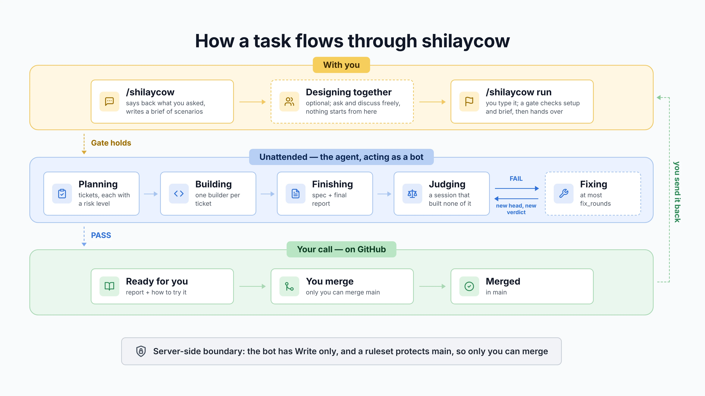

# shilaycow

A development harness for Claude Code (the desktop app and cloud sessions):

- **18 skills you can use on their own**, one for each practice in the development cycle.
- **Chief mode** (`shilaycow-chief`), which composes them so an agent can take a task from a request to a pull request you can merge.
- **A boundary on GitHub's servers**: whatever the agent does, only you can change `main`.

The idea: loosen the reins on the agent as far as possible, and let the harness protect the repository only where a mistake would cost you. Quality comes from checking results (independent verification, reading the code, breaking a behaviour to see its test fail), not from prescribing a process.

**How it works, with diagrams:** [ARCHITECTURE.md](ARCHITECTURE.md).

Not meant for projects with production environments, real users or real data.

<p align="center">
  
</p>

## Install

The skills do not go into your project. They are installed where Claude Code reads user-level skills (`~/.claude/skills/`), always with the same command:

```bash
git clone -q --depth 1 https://github.com/pitaya943/shilaycow.git /tmp/shilaycow-src && mkdir -p ~/.claude/skills && cp -r /tmp/shilaycow-src/plugin/skills/. ~/.claude/skills/
```

### Cloud sessions (the main way to use it)

1. Create a cloud environment in Claude Code and paste the contents of [`plugin/skills/shilaycow-setup/install-skills.sh`](plugin/skills/shilaycow-setup/install-skills.sh) into its **Setup script**. Its network must reach `github.com`.
2. Start this project's sessions in that environment. Every new session has all the skills from the start; the sessions it starts (builders, verifiers) use the same environment by default, so they have them too. Your project's own `.claude/skills/` (such as `try-<app>`) loads alongside them as usual.

Each session gets the latest version. To stay on one version, add `--branch <tag>` to the script's `git clone`, for example `--branch v0.3.1`. Every version is a tag of this repository.

### Your own computer

Only needed if you want the skills in local sessions: run the command above once in a terminal, and again to update. Every skill name starts with `shilaycow-`, so none of your own personal skills is overwritten. The command copies and never deletes: if a later version removes or renames a skill, delete the old folder yourself.

### What does not work

- **Declaring a plugin marketplace in your project's `.claude/settings.json`** (`extraKnownMarketplaces`, `enabledPlugins`): cloud sessions do not load it, and show no error. Claude Code's documentation says so.
- **`/plugin install` on your own computer:** only local sessions get it; the cloud container does not have it. Beware that the desktop app's menu still shows it in cloud sessions (with a colon, such as `shilaycow:chief`), but choosing it finds nothing. What works in the cloud is the set the setup script installs, named with a hyphen (`shilaycow-chief`). If you installed both, removing the local plugin avoids picking the wrong one.
- **Copying `plugin/skills/` into your project's `.claude/skills/` and committing it** works, but every project gets its own copy that you must update by hand. Not recommended.

## Start a project

**A few skills on their own (Level 1).** Once installed, call them directly, for example `shilaycow-sharpen`, `shilaycow-how`, `shilaycow-why`, `shilaycow-prove`, `shilaycow-principles`. Nothing else to set up.

**Let the agent do whole tasks (Levels 2 to 4).** Everything can be done in a browser and the Claude Code desktop app; no terminal needed.

1. Create a GitHub account for a bot. Connect GitHub on claude.ai to that account, and install the Claude GitHub App on your repository. From then on sessions work as the bot; do not switch the connection in the middle of a session.
2. In the environment with the skills installed, start a session on your repository and call `shilaycow-setup`. It walks you through the two things only you can do on github.com (invite the bot as a collaborator with the Write role; import the ruleset that protects `main`), and does the rest itself: writes the config, opens a setup pull request, and checks that the rules are in force.
3. Merge that setup pull request.
4. Start a session, call `shilaycow-chief` and describe the task. It says back what it understood and writes a brief; only after you approve and say start does the unattended part begin.
5. Read the final pull request, try it with its "how to try it" steps, and merge. If you find something wrong after merging, leave one comment on the task's tracking issue: that is how the next task learns what verification missed.

Those two steps must be done by you, because the agent's account must not be able to change repository settings: that is the very boundary protecting `main`.

If your computer has `gh` signed in as you, you can also call `shilaycow-setup` in a local session, and it does those two steps for you.

## The 18 skills

| Phase | Skill | In one line |
|---|---|---|
| Early | `shilaycow-sharpen` | say back what you want, then write it as a brief of scenarios you approve |
| Early | `shilaycow-how` | explain how a part of the system works now |
| Early | `shilaycow-why` | answer why something is the way it is, from the record |
| Throughout | `shilaycow-spec` | keep `docs/spec/` true: what the whole system does now, by area |
| Middle | `shilaycow-design` | derive the system's shape from the scenarios |
| Middle | `shilaycow-plan` | cut the work into tickets, with dependencies and what can run in parallel |
| Middle | `shilaycow-prove` | decide how each behaviour is proven; never by a test that cannot fail |
| Late | `shilaycow-verify` | a session that built none of it runs six checks and posts PASS or FAIL |
| Late | `shilaycow-try-it` | generate your project's own skill for starting and driving the app |
| Late | `shilaycow-blast-radius` | find what a change could break elsewhere, and prove it by running code |
| Late | `shilaycow-trail` | one row per decision made in place of asking |
| Late | `shilaycow-report` | write it up for the person deciding whether to merge |
| End of cycle | `shilaycow-retro` | record the pitfalls this task hit so the next one does not |
| End of cycle | `shilaycow-correct` | when a mistake recurs, change the repository so it cannot happen again |
| Composition | `shilaycow-chief` | Chief mode: a few fixed boundaries, everything else the agent's judgement |
| Setup | `shilaycow-setup` | once per repository: the bot, the ruleset, the config |
| Setup | `shilaycow-status` | read only: where a task stands, who it waits on, what is next |
| Throughout | `shilaycow-principles` | seven judgements a good engineer applies; knowledge, not rules |

Each skill's full instructions are in `plugin/skills/<name>/SKILL.md`.

## Credits

Everything here is written from scratch; no text is copied from other projects. Some ideas come from [pstack](https://github.com/cursor/plugins/tree/main/pstack) (MIT) and [Matt Pocock's skills](https://github.com/mattpocock/skills) (MIT).

## License

MIT, see [LICENSE](LICENSE).
